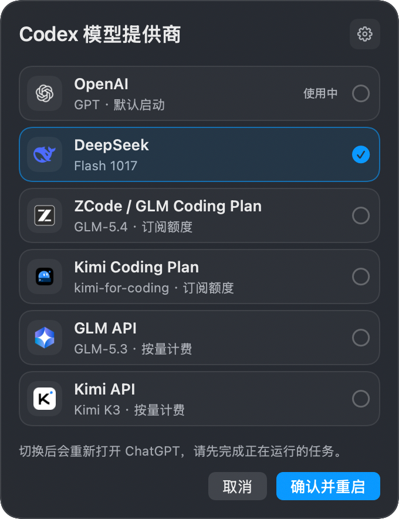

<p align="center">
  
</p>

<h1 align="center">Provider Switcher for Codex</h1>

<p align="center">Choose a provider from the macOS menu bar, then confirm to open a new local Codex Desktop session.</p>

<p align="center">
  <a href="https://github.com/caseclose/codex-provider-switcher/releases/latest">Download for macOS</a>
  · <a href="https://caseclose.github.io/codex-provider-switcher/">Project website</a>
  · <a href="#中文说明">中文说明</a>
</p>

<p align="center"><sub>macOS 14+ · Apple silicon and Intel · MIT</sub></p>

## Quick start

1. Install and open the official ChatGPT desktop app at least once. The switcher requires macOS 14 or later. The release contains a universal binary for Apple silicon and Intel.
2. Download `Codex-Provider-Switcher-macOS.zip` from [Releases](https://github.com/caseclose/codex-provider-switcher/releases/latest). Unzip it and move the app to Applications. The build is ad-hoc signed and has not been Apple-notarized. You can also [build it locally](#build).
3. Open the switcher. Click its menu bar icon, choose a provider, then confirm. If ChatGPT is open, switching quits and reopens it. Finish active work first and start a fresh local Codex session after switching.

<p align="center">
  
</p>

## Settings

Open the gear in the menu bar panel to choose Simplified Chinese, Traditional Chinese, English, or Japanese, and System, Light, or Dark appearance. The default appearance follows macOS. The **About** section shows the installed version, checks GitHub for the latest stable release, and links to the issue form.

The panel opens directly below the menu bar. On smaller displays, the provider list scrolls while the header and confirmation controls remain in view.

The website also follows system appearance by default. Read it in [简体中文](https://caseclose.github.io/codex-provider-switcher/?lang=zh-Hans), [繁體中文](https://caseclose.github.io/codex-provider-switcher/?lang=zh-Hant), [English](https://caseclose.github.io/codex-provider-switcher/?lang=en), or [日本語](https://caseclose.github.io/codex-provider-switcher/?lang=ja).

## Providers

| Menu option | Default model | Access |
| --- | --- | --- |
| OpenAI | Desktop default | Your usual Codex sign-in and configuration |
| DeepSeek | `deepseek-flash` | [DeepSeek API](#set-up-deepseek-once) |
| ZCode / GLM Coding Plan | `glm-5.4` | GLM Coding Plan API key from BigModel or Z.ai |
| Kimi Coding Plan | `kimi-for-coding` | Kimi Code API key from the Kimi Code console |
| GLM API | `glm-5.3` | Pay-as-you-go API key from BigModel or Z.ai |
| Kimi API | `kimi-k3` | Pay-as-you-go API key from Moonshot Open Platform |

### Set up GLM or Kimi

1. Create an API key for the option you want. For ZCode, use a key from the GLM Coding Plan associated with your account. For Kimi Coding Plan, create a key in the Kimi Code console.
2. In the switcher, select the provider and the region that issued your key. Click **设置 API Key** (Set API Key), paste it and save. Each provider and region has its own macOS Keychain item.
3. Confirm the switch and start a new local Codex session. If macOS asks whether `security` may access the Keychain item for this provider, allow the lookup to continue.

GLM and Kimi requests go directly to the official regional Responses endpoint. A preset applies to the current launch. OpenAI uses your normal desktop startup. To keep OpenAI as the default for normal launches, leave `model_provider` unset in `~/.codex/config.toml` or set it to `"openai"`. The switcher applies its presets through launch arguments and leaves the configuration file intact.

| Provider | Mainland China | International |
| --- | --- | --- |
| GLM Coding Plan / GLM API | `https://open.bigmodel.cn/api/v1` | `https://api.z.ai/api/v1` |
| Kimi Coding Plan | `https://api.kimi.com/coding/v1` | `https://api.kimi.ai/coding/v1` |
| Kimi API | `https://api.moonshot.cn/v1` | `https://api.moonshot.ai/v1` |

Official guides · [BigModel Coding Plan](https://docs.bigmodel.cn/cn/coding-plan/tool/codex) · [Z.ai Coding Plan](https://docs.z.ai/devpack/tool/codex) · [GLM-5.3 API](https://docs.bigmodel.cn/cn/guide/models/text/glm-5.3) · [Kimi Code](https://www.kimi.com/code/docs/third-party-tools/codex.html) · [Kimi API](https://www.kimi.ai/resources/codex-api)

## Set up DeepSeek once

If your Codex config already has a working provider called `deepseek`, you can use it with the switcher. To set it up for the first time, follow these steps.

1. Create a DeepSeek API key in the [DeepSeek developer platform](https://platform.deepseek.com/).
2. Open **Keychain Access** and select your **login** keychain. Choose **File → New Password Item**. Name the item `codex-provider-deepseek` and enter your DeepSeek key in the password field.
3. Add this provider to `~/.codex/config.toml`. Keep any existing OpenAI or unrelated settings. If this named provider already exists, merge its settings instead of appending a duplicate table.

```toml
[model_providers.deepseek]
name = "DeepSeek"
base_url = "https://api.deepseek.com"
wire_api = "responses"

[model_providers.deepseek.auth]
command = "/usr/bin/security"
args = ["find-generic-password", "-s", "codex-provider-deepseek", "-w"]
timeout_ms = 10000
```

If macOS prompts for Keychain access when switching, approve the lookup for the key you just saved. DeepSeek requests go to its official API and are billed by DeepSeek. The app bundles a Codex model catalog for `deepseek-flash` and supplies it only to the DeepSeek launch. The switcher uses a desktop CLI-path override and the bundled Codex executable, so desktop updates may affect compatibility.

## Build

On macOS with Xcode Command Line Tools installed, run:

```bash
./scripts/build.sh
```

The build downloads provider artwork from the official sources and writes the signed app bundle under `dist/`. An optional first argument sets the output directory.

## 中文说明

从 macOS 菜单栏打开切换器，可选 **OpenAI**、**DeepSeek**、**ZCode / GLM Coding Plan**、**Kimi Coding Plan**、**GLM API** 或 **Kimi API**。切换后新建一个本地 Codex 会话。

首次使用 GLM 或 Kimi 时，选择密钥所属地区，点击「设置 API Key」并保存。套餐与按量 API 使用各自的凭据，密钥保存在 macOS 钥匙串。DeepSeek 沿用上文的 `deepseek` 配置。

## License

MIT for the project code and original switcher artwork. The provider marks belong to their respective owners. See [third-party notices](THIRD_PARTY_NOTICES.md).
