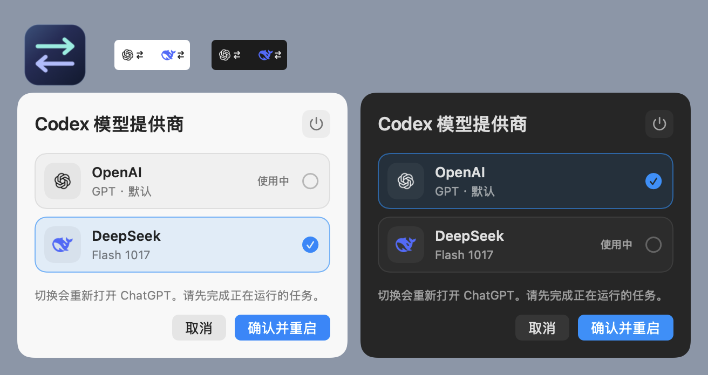

# Provider Switcher for Codex

A small macOS menu bar utility for starting local Codex sessions with OpenAI or DeepSeek Flash 1017.

[Download for macOS](https://github.com/caseclose/codex-provider-switcher/releases/latest) · [Project website](https://caseclose.github.io/codex-provider-switcher/) · [中文](#中文说明)



## Install

1. Install and open the official ChatGPT desktop app at least once. The switcher requires macOS 14 or later. The release contains a universal binary for Apple silicon and Intel.
2. Download `Codex-Provider-Switcher-macOS.zip` from [Releases](https://github.com/caseclose/codex-provider-switcher/releases/latest). Unzip it and move the app to Applications. The build is ad-hoc signed and has not been Apple-notarized. You can also [build it locally](#build).
3. Open the switcher. Click its menu bar icon, choose a provider, then confirm. If ChatGPT is open, switching quits and reopens it. Finish active work first and start a fresh local Codex session after switching.

OpenAI uses your normal desktop startup. To retain OpenAI as the default, keep `model_provider = "openai"` near the top of `~/.codex/config.toml`, or leave that setting unset. DeepSeek is selected for the current launch only. The switcher does not write to your Codex configuration.

## Set up DeepSeek once

This step is only for DeepSeek. If your Codex config already has a working provider called `deepseek`, use it as-is. Otherwise:

1. Create a DeepSeek API key in the [DeepSeek developer platform](https://platform.deepseek.com/).
2. Open **Keychain Access** and select your **login** keychain. Choose **File → New Password Item**. Name the item `codex-provider-deepseek` and enter your DeepSeek key in the password field.
3. Add this provider to `~/.codex/config.toml`. Keep any existing OpenAI or unrelated settings. If this named provider already exists, merge its settings instead of appending a duplicate table.

```toml
[model_providers.deepseek]
name = "DeepSeek"
base_url = "https://api.deepseek.com"
wire_api = "responses"

[model_providers.deepseek.auth]
command = "/usr/bin/security"
args = ["find-generic-password", "-s", "codex-provider-deepseek", "-w"]
timeout_ms = 10000
```

If macOS prompts for Keychain access when switching, approve the lookup for the key you just saved. DeepSeek requests go to its official API and are billed by DeepSeek. The app bundles a Codex model catalog for `deepseek-flash` and supplies it only to the DeepSeek launch. The switcher uses a desktop CLI-path override and the bundled Codex executable, so desktop updates may affect compatibility.

## Build

On macOS with Xcode Command Line Tools installed, run:

```bash
./scripts/build.sh
```

The build downloads provider artwork from the official sources and writes the signed app bundle under `dist/`. An optional first argument sets the output directory.

## 中文说明

这是一个 macOS 菜单栏工具。点击小图标打开面板，选择 **OpenAI** 或 **DeepSeek Flash 1017**，确认后才会重新打开 ChatGPT。再新建一个本地 Codex 会话即可。普通启动继续使用你原本的默认提供商。

使用 DeepSeek 前，需要在 Codex 里配置名为 `deepseek` 的提供商。上面的配置把 API Key 存在 macOS 钥匙串，推理请求直连 DeepSeek 官方 API。

## License

MIT for the project code and original switcher artwork. The provider marks belong to their respective owners. See [third-party notices](THIRD_PARTY_NOTICES.md).
